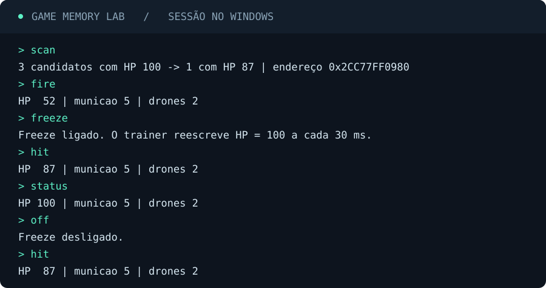

# Game Memory Lab

**Uma arena offline e um trainer externo para Windows.** Encontre a vida do personagem comparando duas leituras de memória. Depois, ligue o freeze e veja a vida voltar a 100 após um ataque.

## Rode o laboratório

Você precisa do Windows e do Python 3.10 ou superior. O projeto usa apenas a biblioteca padrão. Abra o terminal na pasta do projeto e rode `py -3 trainer.py`.

| Comando | O que acontece |
| --- | --- |
| `scan` | Reinicia a arena, encontra três valores iguais a 100 e provoca um dano de 13 para isolar o HP. |
| `fire` | Gasta uma munição e destrói um drone. Os drones restantes contra-atacam. |
| `freeze` | Restaura o HP a 100 e começa a reescrever esse valor em segundo plano. |
| `hit` | Provoca dano de 13 para comparar o HP com e sem freeze. |
| `status` | Mostra o estado atual da arena. |
| `off` / `reset` / `quit` | Desliga o freeze, reinicia a rodada ou sai do laboratório, respectivamente. |

Experimente `scan`, `fire`, `freeze`, `hit`, `status`, `off` e `hit`. Com o freeze ligado, `hit` pode mostrar o dano brevemente. O próximo `status` mostra a recuperação após o ciclo de escrita.

## Como o endereço foi encontrado

1. A arena guarda 64 valores de 32 bits numa região de 256 bytes. A posição do HP muda a cada processo e dois valores de distração também começam em 100.
2. O trainer inicia a arena e recebe o endereço inicial e o tamanho da região. Ele lê os bytes do processo filho com `ReadProcessMemory` e interpreta os valores como inteiros de 32 bits em little-endian.
3. Depois de um dano controlado, o trainer lê a região outra vez. Só um dos três candidatos caiu de 100 para 87. O endereço é a base da região mais o índice desse candidato multiplicado por quatro.
4. `WriteProcessMemory` grava quatro bytes nesse endereço. O freeze repete a gravação a cada 30 ms até ser desligado.

O processo filho é o único alvo do trainer. A arena informa os limites da região para que o exercício se concentre na busca diferencial. O ciclo de 30 ms é uma restauração periódica, por isso existe uma janela em que o jogo pode observar o dano antes da próxima gravação.

## Verificação

`py -3 -m unittest -v` executa um teste de ponta a ponta. Ele confirma a busca, o dano normal, a recuperação com freeze e a volta do dano depois de desligá-lo.

[Documentação de leitura de memória](https://learn.microsoft.com/windows/win32/api/memoryapi/nf-memoryapi-readprocessmemory) · [Documentação de escrita de memória](https://learn.microsoft.com/windows/win32/api/memoryapi/nf-memoryapi-writeprocessmemory)
